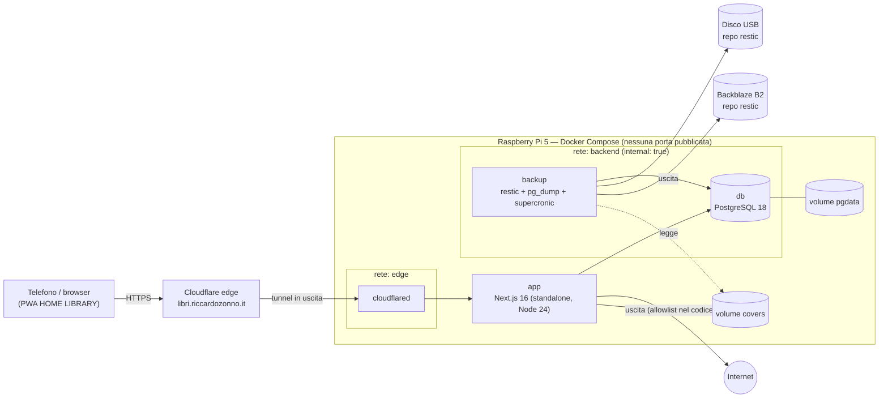

# Architettura

## Vista d'insieme



- **`app`** è collegata a `edge` (raggiungibile da cloudflared, con uscita verso internet per le API dei libri) e a `backend` (database). Docker non filtra il traffico in uscita per host: il limite agli host di Google Books/Open Library è applicato dal codice.
- **Ruoli DB**: l'app usa il ruolo `app` (DML, niente `UPDATE`/`DELETE` su `AuditLog`); `migrate` usa `migrator`, proprietario dello schema.
- **`db`** è solo su `backend` (`internal: true`, senza accesso a internet): la raggiungono solo `app`, `migrate` e `backup`.
- **`backup`** è su `backend` e su una rete `egress` propria per B2.
- **Nessun servizio pubblica porte sull'host.** In sviluppo un file `compose.override.yaml` espone l'app solo su `127.0.0.1:3000`.
- **`migrate`** è un servizio "one-shot" (`prisma migrate deploy`) eseguito dallo script di aggiornamento prima di riavviare l'app.

## Applicazione

```
src/
  app/                     # App Router: pagine, layout, route handler (api/auth, api/covers, api/health, export CSV)
    (auth)/                # login, invito, reset
    (app)/                 # area protetta: catalogo, libro/[id], aggiungi, sedi, admin/*, profilo
  components/              # UI riutilizzabile (client solo dove serve: scanner, form interattivi)
  server/                  # solo lato server ("server-only")
    auth/                  # config Better Auth, sessione, lockout, Mailer
    policy.ts              # matrice dei permessi: funzioni pure
    actor.ts               # carica utente+ruolo+sedi dal DB a ogni richiesta
    audit.ts               # withAudit(tx, ...)
    catalog/ locations/ copies/ users/ readings/ csv/   # servizi di dominio (repository Prisma + regole)
    isbn/                  # normalizzazione, client Google Books / Open Library, cache
    covers/                # download da host consentiti, ricodifica con sharp, salvataggio
  lib/                     # utilità condivise e schemi zod
prisma/                    # schema e migrazioni
tests/                     # unit, integration (Postgres di test), e2e (Playwright)
ops/                       # Dockerfile del backup, script setup/update/backup/restore
```

### Flusso di ogni scrittura
1. Server Action (o Route Handler) riceve l'input.
2. Validazione **zod** → errore leggibile in italiano se non valido.
3. `getActor()`: sessione Better Auth → utente **ricaricato dal DB** (ruolo, attivo, sedi). Sessione assente/utente disattivato → 401.
4. `policy.can(actor, azione, risorsa)` → 403 se negato.
5. Servizio di dominio in **una transazione Prisma**: lettura con i vincoli, scrittura, riga di audit.
6. `revalidatePath` e risposta.

Le letture seguono 1–4 (i lettori vedono tutto, ma serve comunque una sessione valida).

### Sicurezza (sintesi; dettagli negli ADR)
| Tema | Soluzione |
|---|---|
| Password | Better Auth con hash **argon2id** (`@node-rs/argon2`), min 12, max 128 caratteri |
| Sessioni | Cookie Better Auth `httpOnly`, `Secure`, `SameSite=Lax`, prefisso `__Secure-`; 30 giorni rinnovati con l'uso; revoca totale; `cookieCache` spento così le revoche sono immediate |
| Superficie Better Auth | Campi `role`/`active`/blocco con `input: false`; disattivati `/sign-up/email`, `/update-user`, `/change-email`, `/delete-user`, `/request-password-reset`; `baseURL` fisso da `.env` |
| CSRF | Controllo `Origin` di Better Auth sulle sue rotte; Server Actions con controllo `Origin`/`Host` di Next; Route Handler mutanti con controllo `Origin` esplicito; `trustedOrigins` = solo il dominio |
| Brute force | Rate limit Better Auth per IP (in DB) + blocco per account (5 errori → 15 min) |
| IP reale | `CF-Connecting-IP` (`ipAddressHeaders`); affidabile perché l'unica via d'ingresso all'app è cloudflared sulla rete interna; in produzione richieste senza header rifiutate |
| Upload e CSV | Foto ridimensionate nel browser, max 4 MB lato server; CSV max 2 MB / 10.000 righe; export con celle che iniziano con `= + - @` neutralizzate (formula injection) |
| Header | CSP con nonce (in `proxy.ts`), `frame-ancestors 'none'`, HSTS, `Referrer-Policy`, `Permissions-Policy: camera=(self)`, `X-Content-Type-Options` |
| Input esterni | Risposte delle API dei libri validate con zod; copertine scaricate solo da host consentiti, limite di dimensione, ricodificate con sharp |
| Segreti | Solo in `.env` (permessi 600), mai nel client; `.env.example` documentato |

### Frontend
- Server Components per default; Client Components solo per scanner, form con stato e menu.
- Tailwind 4, componenti propri sobri in stile iOS; barra di navigazione in basso su telefono (Catalogo · Aggiungi · Sedi · Profilo, più Admin per gli admin).
- Accessibilità: target tattili ≥ 44 px, contrasto AA, focus visibile, etichette su tutti i campi, annunci `aria-live` per scanner ed errori.
- PWA: `app/manifest.ts`, icone (inclusa `apple-touch-icon`, proposte in `design/icon-a.svg` e `design/icon-b.svg`), service worker minimale: cache solo degli asset statici con hash e del WASM dello scanner, pagina offline; **mai** HTML, dati o `/api/covers`; cache svuotata al logout.

## Ambienti
| | Sviluppo (Mac M5 Pro) | Produzione (Pi 5) |
|---|---|---|
| Container | OrbStack, arm64 | Docker Engine, arm64 |
| Accesso | `http://localhost:3000`; per l'iPhone tunnel temporaneo `trycloudflare` | `https://libri.riccardozonno.it` via tunnel |
| DB | Postgres nel compose + DB di test separato su tmpfs | Postgres nel compose, volume su SSD |
| 2FA admin | facoltativa | obbligatoria (`REQUIRE_ADMIN_2FA=true`) |

## Dipendenze principali (versioni stabili al 29/10/2026)
Next.js 16.4 · React 19.3 · TypeScript (strict) · Prisma 7.10 · PostgreSQL 18 · Better Auth 1.7 · zod 4 · Tailwind 4 · barcode-detector 3 (zxing-wasm) · sharp · Vitest 5 · Playwright 1.64 · restic · cloudflared.
