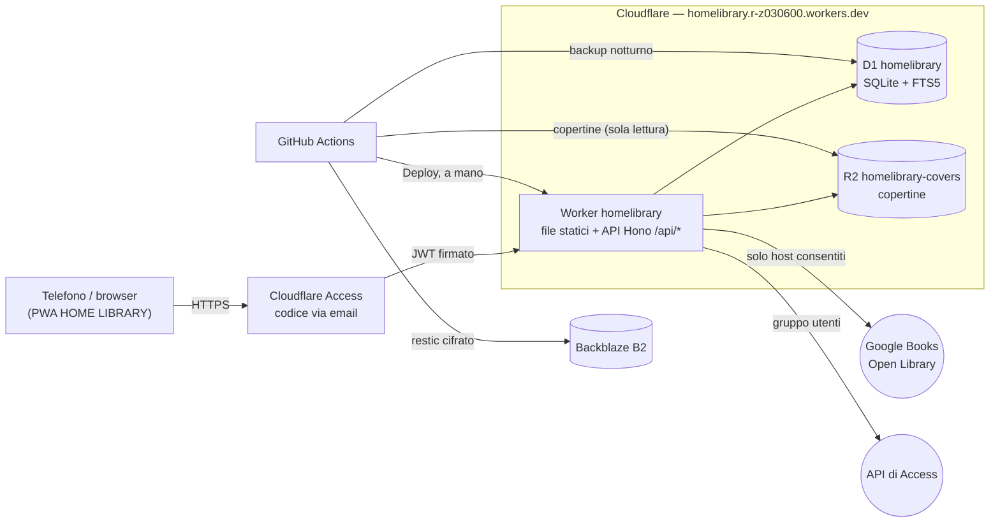

# Architettura (v2, Cloudflare)

Tutto sul piano gratuito di Cloudflare, senza server e senza dominio. La v1 (Next.js + Postgres + Docker
su Raspberry Pi) è descritta nel tag `v1-nextjs`. Decisione: [ADR-0014](adr/0014-riscrittura-cloudflare.md).

## Vista d'insieme

## Le parti

| Parte | Cosa fa | Codice |
|---|---|---|
| Interfaccia | SPA React 19 + Vite, installabile (PWA). I file statici li serve Cloudflare senza usare CPU del Worker | `src/` |
| API | Hono su Workers, solo `/api/*` (`run_worker_first`) | `worker/` |
| Regole condivise | permessi, ISBN, validazioni zod, formato CSV: usate da interfaccia e API | `shared/` |
| Database | D1 con Drizzle; ricerca FTS5 senza accenti; registro attività in sola aggiunta (trigger) | `worker/db/`, `migrations/` |
| Copertine | R2: foto caricate (max 2 MB) o scaricate dalla ricerca ISBN | `worker/covers/` |
| Accesso | Cloudflare Access (One-time PIN). Il Worker verifica il JWT con WebCrypto e rilegge utente, ruolo e sedi da D1 a ogni richiesta | `worker/auth/` |

## Una richiesta all'API

1. Access controlla la sessione (un mese) o chiede il codice via email; chi non è nel gruppo «Utenti HOME LIBRARY» si ferma qui.
2. Il Worker controlla dimensione e tipo della richiesta, l'origine per le scritture (CSRF) e i limiti di frequenza per persona.
3. Verifica firma, audience e scadenza del JWT; carica l'utente da D1 (attivo, non uscito da tutti i dispositivi).
4. `can()` di `shared/policy.ts` decide; la scrittura e la sua riga di registro vanno in un unico batch D1, con la stessa condizione.

## Vincoli del piano gratuito

- **10 ms di CPU per richiesta**: misurati 1–7 ms a regime, 11–17 ms al primo avvio di un'istanza (accettato; le letture fallite si ripetono una volta). Controllo settimanale automatico ([backup-restore.md](backup-restore.md)).
- **D1**: niente transazioni interattive (si usano batch con condizioni), massimo 100 parametri per istruzione.
- **Limiti giornalieri** (richieste, righe lette/scritte): lontani per una famiglia; il controllo settimanale avvisa se ci si avvicina.

## Dove sono configurati

| Cosa | Dove |
|---|---|
| Binding, variabili, limiti di frequenza | `wrangler.jsonc` |
| Segreti del Worker (`GOOGLE_BOOKS_API_KEY`, `CF_API_TOKEN`) | Cloudflare, `wrangler secret put` |
| Access (metodo, regola, durata) | dashboard Zero Trust, vedi [produzione.md](produzione.md) |
| CI, deploy, backup | `.github/workflows/`, segreti GitHub |
