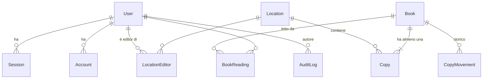

# Modello dati

PostgreSQL 18 + Prisma 7. Nomi in inglese nel codice, interfaccia in italiano.



## Schema (bozza)

```prisma
enum Role { ADMIN EDITOR READER }
enum BookSource { GOOGLE_BOOKS OPEN_LIBRARY MANUAL CSV }

// --- Tabelle di Better Auth (user/session/account/verification/twoFactor) ---
model User {
  id                String    @id @db.Uuid      // Better Auth con advanced.database.generateId: "uuid"
  name              String
  email             String    @unique           // salvata in minuscolo
  emailVerified     Boolean   @default(false)
  image             String?
  // i 4 campi seguenti sono additionalFields di Better Auth con input: false (mai dal client)
  role              Role      @default(READER)
  active            Boolean   @default(true)    // disattivato = niente login, sessioni revocate
  failedLoginCount  Int       @default(0)
  lockedUntil       DateTime?
  twoFactorEnabled  Boolean   @default(false)
  createdAt         DateTime  @default(now())
  updatedAt         DateTime  @updatedAt
  editorOf          LocationEditor[]
  readings          BookReading[]
  // + relazioni Better Auth: sessions, accounts, twoFactor
}
// Session, Account (hash argon2id della password nel campo password), Verification
// (token di invito/reset; con storeIdentifier "hashed" nel DB c'è solo l'hash), TwoFactor:
// schema generato da Better Auth. Rate limit in memoria: nessuna tabella.

model Location {
  id          String    @id @default(uuid(7)) @db.Uuid
  name        String
  nameKey     String    @unique                // nome normalizzato (minuscolo, senza accenti/spazi doppi)
  archivedAt  DateTime?
  createdAt   DateTime  @default(now())
  updatedAt   DateTime  @updatedAt
  copies      Copy[]
  editors     LocationEditor[]
}

model LocationEditor {
  userId      String   @db.Uuid                // FK User, Cascade
  locationId  String   @db.Uuid                // FK Location, Cascade
  createdAt   DateTime @default(now())
  @@id([userId, locationId])
  @@index([locationId])
}

model Book {
  id            String     @id @default(uuid(7)) @db.Uuid
  isbn13        String?    @unique                // normalizzato (ISBN-10 convertito); null = senza ISBN
  title         String
  authors       String[]                          // in ordine
  publishedYear Int?
  description   String?
  coverPath     String?                           // file WebP nel volume covers/
  source        BookSource
  searchText    String                            // titolo+autori+isbn, minuscolo, senza accenti
  createdById   String?                           // SetNull: l'utente non viene mai cancellato, solo disattivato
  createdAt     DateTime   @default(now())
  updatedAt     DateTime   @updatedAt
  copies        Copy[]
  readings      BookReading[]
  movements     CopyMovement[]
  @@index([searchText(ops: raw("gin_trgm_ops"))], type: Gin)   // richiede l'estensione pg_trgm
  @@index([title])
}

model Copy {
  id          String    @id @default(uuid(7)) @db.Uuid
  bookId      String    @db.Uuid                 // onDelete: Cascade
  locationId  String    @db.Uuid                 // onDelete: Restrict (le sedi si archiviano, non si cancellano)
  shelf       String?                            // collocazione: "Scaffale 3, ripiano 2"
  notes       String?
  createdById String?
  createdAt   DateTime  @default(now())
  updatedAt   DateTime  @updatedAt
  @@index([locationId])
  @@index([bookId])
}

model CopyMovement {
  id              String   @id @default(uuid(7)) @db.Uuid
  bookId          String   @db.Uuid               // Cascade; lo storico resta sul libro anche se la copia viene eliminata
  copyId          String?  @db.Uuid               // SetNull alla cancellazione della copia
  fromLocationId  String   @db.Uuid               // Restrict
  toLocationId    String   @db.Uuid               // Restrict
  movedById       String?  @db.Uuid               // SetNull
  movedAt         DateTime @default(now())
  @@index([bookId, movedAt])
}

model BookReading {
  userId    String
  bookId    String   @db.Uuid                   // onDelete: Cascade
  markedById String   @db.Uuid                   // FK User: chi l'ha segnato (l'utente stesso o un admin)
  createdAt DateTime @default(now())
  @@id([userId, bookId])
  @@index([bookId])
}

model AuditLog {
  id          String   @id @default(uuid(7)) @db.Uuid
  actorId     String?                            // null = sistema (import CLI, migrazioni)
  actorEmail  String?                            // copia per leggibilità storica
  action      String                             // es. "copy.move", "user.role_change"
  entityType  String                             // "book" | "copy" | "location" | "user" | "import"
  entityId    String?
  data        Json                               // { before, after } o dettagli; mai password/token
  ip          String?
  createdAt   DateTime @default(now())
  @@index([createdAt(sort: Desc)])
  @@index([entityType, entityId])
  @@index([actorId, createdAt])
}
```

## Regole di integrità

| Regola | Dove è applicata |
|---|---|
| ISBN sempre ISBN-13 valido (checksum) o null | zod + funzione `normalizeIsbn` |
| Un libro ha sempre ≥ 1 copia | Servizio: creazione libro+copia nella stessa transazione; aggiunta/eliminazione/spostamento bloccano la riga del libro (`FOR UPDATE`) prima di contare le copie; eliminare l'ultima copia (= eliminare il libro) è riservato all'admin (file copertina rimosso dopo il commit, istantanea completa nell'audit) |
| ISBN creato in contemporanea da due persone | L'errore di unicità P2002 diventa la proposta "aggiungi una copia" |
| Niente copie nuove o in arrivo in sedi archiviate | Servizio + policy |
| Nome sede unico ignorando maiuscole e accenti | Colonna `nameKey @unique` calcolata dall'app |
| Sempre almeno un admin attivo | Servizio utenti: `pg_advisory_xact_lock` dedicato, poi conteggio degli admin attivi, nella stessa transazione della modifica |
| Audit non modificabile | Ruolo DB `app` senza `UPDATE`/`DELETE` su `AuditLog`; le migrazioni usano il ruolo `migrator` |
| Ogni modifica genera una riga di `AuditLog` nella stessa transazione | Helper `withAudit(tx, …)` usato da tutti i servizi |
| Utenti mai cancellati fisicamente | Solo `active = false` (preserva audit e storico) |

## Ricerca
`searchText` è calcolato dall'app (NFD → rimozione diacritici → minuscolo) a ogni scrittura. La query normalizza l'input allo stesso modo e usa `ILIKE '%…%'` accelerato da un indice GIN `pg_trgm` dichiarato nello schema (estensione creata nella prima migrazione). Per qualche migliaio di libri è immediato e non richiede l'estensione `unaccent`. Paginazione a offset (24 per pagina), ordinamento per titolo.

## Volumi di dati
- Database: pochi MB.
- Copertine WebP ricodificate (max 600 px di lato lungo): ~30–60 KB ciascuna → ~100–200 MB per 3000 libri.
