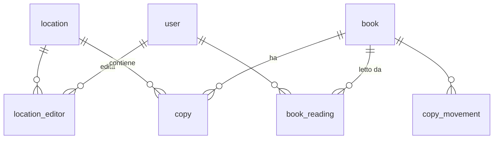

# Modello dati (v2, D1)

SQLite su D1, schema in `worker/db/schema.ts` (Drizzle) e migrazioni in `migrations/`. Id UUID come
testo, date ISO 8601 UTC come testo. Nomi in inglese nel codice, interfaccia in italiano. Il modello
della v1 (Postgres + Prisma) è nel tag `v1-nextjs`.

| Tabella | Contenuto | Regole principali |
|---|---|---|
| `user` | email (identità di Access), nome, ruolo, attivo, `sessions_not_before` | email unica e minuscola; ruolo ADMIN/EDITOR/READER |
| `location` | sede: nome, colore, archiviazione | nome unico senza maiuscole/accenti (`name_key`); un colore per sede |
| `location_editor` | quali sedi può modificare un editor | chiave utente + sede |
| `book` | dati bibliografici, genere, `cover_key` in R2, origine (Google Books, Open Library, a mano, CSV) | ISBN-13 unico se presente; autori come array JSON; genere tra quelli di `shared/genres.ts` (controllato nel codice, non con un CHECK: cambiare l'elenco non richiede di ricostruire la tabella); `seq` numerico stabile per la ricerca |
| `copy` | copia fisica in una sede, scaffale e note | una sede non si cancella se ha copie (`restrict`) |
| `copy_movement` | storico degli spostamenti | resta anche se la copia viene eliminata |
| `book_reading` | chi ha letto il libro, chi l'ha segnato e quando, voto 1–5 del lettore | chiave utente + libro; voto nullo o tra 1 e 5; se si toglie «Letto» il voto sparisce con la riga |
| `book_current_reading` | «Sto leggendo»: chi, chi l'ha segnato, data di inizio (salvata, non mostrata) | chiave utente + libro; mai su un libro già letto; segnare «Letto» toglie la riga |
| `audit_log` | registro attività: chi, cosa, quando, dati prima/dopo | in sola aggiunta: trigger che vietano UPDATE e DELETE; mai segreti |
| `isbn_cache` | risposte positive di Google Books / Open Library | evita chiamate ripetute |
| `book_fts` | indice FTS5 su titolo, autori, ISBN, senza accenti | riempito dai trigger su `book` (si ricostruisce da solo in un ripristino) |

Indici per il catalogo: titolo senza maiuscole + `seq` (paginazione), copie per libro e sede, copie per
sede. Ordine delle tabelle nel backup (dipendenze): `scripts/backup/lib.mjs`.
