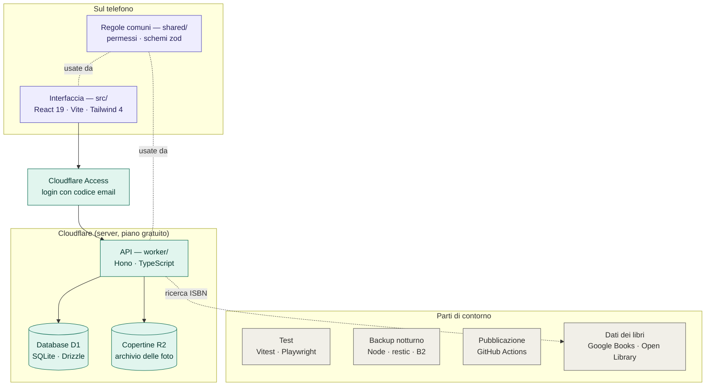

# Schema del codice

Mappa delle parti del codice, con linguaggi e framework. Come funziona in produzione (richieste, Access,
dati) è in [architecture.md](architecture.md).

Quasi tutto è **TypeScript**; fanno eccezione lo SQL delle migrazioni, gli script di backup in JavaScript
(Node) e il YAML di GitHub Actions. Circa 6.500 righe di codice e 3.500 di test (novembre 2026).

Viola: gira sul telefono · Verde acqua: Cloudflare · Grigio: parti di contorno.

## Parti principali

| Parte | Cartella | Tecnologie | Cosa fa |
|---|---|---|---|
| Interfaccia | [src/](../src/) | React 19, Vite 8, react-router, Tailwind CSS 4 | Le pagine (Catalogo, scheda libro, Aggiungi con lo scanner, Statistiche, Admin). PWA installabile, con service worker in [public/sw.js](../public/sw.js). |
| API | [worker/](../worker/) | Hono su Cloudflare Workers, zod | Risponde a `/api/*`, divisa per argomento (catalogo, letture, sedi, utenti, ISBN, copertine, CSV, statistiche, registro); controlla login, permessi e limiti di richieste. |
| Regole comuni | [shared/](../shared/) | TypeScript, zod | Codice usato sia dall'interfaccia sia dall'API: permessi ([policy.ts](../shared/policy.ts)), validazione, generi, ISBN, formato CSV. |
| Database | [migrations/](../migrations/), [worker/db/](../worker/db/) | Cloudflare D1 (SQLite), Drizzle ORM, ricerca FTS5 | Libri, copie, sedi, utenti, letture e voti, registro attività ([data-model.md](data-model.md)). |
| Copertine | — | Cloudflare R2 | Le foto delle copertine. |
| Accesso | — | Cloudflare Access | Email e codice prima di arrivare all'app. |

## Parti di contorno

| Parte | Cartella | Tecnologie |
|---|---|---|
| Test unitari e di integrazione | [tests/unit/](../tests/unit/), [tests/worker/](../tests/worker/) | Vitest, con il plugin di Cloudflare per un D1 locale |
| Test sul telefono simulato | [tests/e2e/](../tests/e2e/) | Playwright (iPhone/WebKit e Android/Chromium), axe per l'accessibilità |
| Backup e ripristino | [scripts/backup/](../scripts/backup/) | Node.js, restic, rclone, Backblaze B2 ([backup-restore.md](backup-restore.md)) |
| Pubblicazione e controlli | [.github/workflows/](../.github/workflows/) | GitHub Actions: controlli, Deploy, backup notturno, controllo del lunedì |
| Dati dei libri | [worker/isbn/](../worker/isbn/) | Google Books e Open Library, interrogati dal server |
| Documentazione | [docs/](.) | Markdown: decisioni (ADR), permessi, modello dei dati, backup |

## Il percorso di una richiesta

1. Dal telefono l'interfaccia React chiede i dati a `/api/...`.
2. Cloudflare Access controlla che l'utente abbia fatto il login.
3. L'API Hono verifica i permessi con le regole di `shared/`.
4. Legge o scrive su D1 (e su R2 per le copertine) e risponde in JSON.

I file statici dell'interfaccia li serve direttamente Cloudflare, senza passare dall'API.
